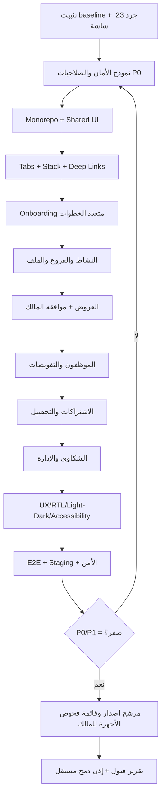

# MUSNAD-WOW — الخطة الرئيسية للصيانة والتأهيل الإنتاجي لتطبيق التاجر

**الإصدار:** V2.0 — 14 نوفمبر 2026  
**الحالة:** **مسودة للمناقشة واعتماد المالك؛ لم يبدأ تنفيذ مراحل هذه الخطة**.  
**النطاق:** 23 شاشة للتاجر، وجميع رحلاته، مع مراجعة البنية المشتركة للتطبيقات الثلاثة دون إعادة تصميم العميل أو الإدارة تلقائيًا.  
**المستودع:** `Musnad-Tech-Official/wow-platform`  
**الفرع:** `maint/merchant-production-readiness` | **PR:** #54 (Draft) | **المرجع:** دمج التطوير #53 في `main` عند `0e42ddb26810da4141640c934376956407a3fd28`.  
**الهدف النهائي:** إغلاق عيوب الجودة والأمان والتكامل، والحصول على **مرشح إصدار هندسي جاهز لاختبارات المالك على الأجهزة الفعلية**. اختبارات الأجهزة الفعلية **مؤجلة للمالك ولم تُنفّذ**. لا تُسمى جاهزية إنتاجية مطلقة قبل إتمام بقية متطلبات النشر والخدمات الخارجية.

## 1. القرار ونطاق السلطة ومصدر الحقيقة

هذا التخطيط امتداد لأسلوب `MUSNAD_WOW_WORKFLOW_V2.2_UPDATED.md`، لا يلغي مراحل تصميم واعتماد الشاشات الست السابقة. المرحلة الحالية **حلقة صيانة هندسية بعد دمج خط الأساس**: جرد ← نقد جذري ← تصميم حل ← تنفيذ على فرع الصيانة ← اختبار ← تصحيح متكرر ← تقرير قبول ← قرار دمج مستقل. يحظر دمج #54 أو النشر بالإنتاج قبل موافقة المالك الصريحة.

**أولوية المصادر:** (1) قرارات المالك الأحدث الصريحة، (2) توثيق المنتج المعتمد بما فيه `PA06/PA09/PA10/PA13` و`UX03`، (3) تصميم الشاشة المعتمد وملف `MER-XX.md`، (4) معمارية TA01–TA06 وV2.2، (5) العقود الفعلية وقاعدة التطوير ونتائج الاختبارات، (6) توصيات المكتبات الرسمية. عند تعارض مصدر تاريخي مع قرار مالك أحدث، يُسجل التعارض ولا يُحل صامتًا.

**لا يُغير أثناء الصيانة دون اعتماد منفصل:** قواعد الربح والدفع، حقوق المالك والموظف، شروط الإثبات والشكاوى، الهوية الرسمية، أعداد الشاشات، مصادقة أصحاب الحسابات، أو تغيير رُتب الإدارة. التعديلات الداخلية وإعادة استخدام المكونات وإصلاحات الأخطاء مسموحة على فرع العمل بعد اعتماد هذه الخطة ضمن الصلاحيات المتفق عليها. لا تُعدل بيانات الإنتاج أو تُمكّن خدمات الإنتاج دون إجراء منفصل.

## 2. خط الأساس الحالي — حقائق مثبتة وليست تقييم جاهزية

- `apps/customer` و`apps/merchant` و`apps/admin`: ثلاثة تطبيقات Expo Router / React Native / React 19 / TypeScript.
- Expo مثبت على `~57.0.31` و`expo-router` على `~57.0.29` في التاجر؛ `pnpm-workspace.yaml` يدير `apps/*` و`packages/*`.
- حزم `@wow/ui` و`@wow/theme` و`@wow/assets` و`@wow/api` و`@wow/auth` مستخدمة فعليًا.
- `@wow/ui` يقدم مكونات كثيرة مشتركة أصلًا: Button/Input/Card/Badge/Dialog/Stepper/SegmentedTabs/Pagination/States. **لا نعيد كتابتها قبل جرد الاستعمال والاختبار.**
- `packages/ui` يضم `integration-test` يستورد `@wow/api` و`@wow/auth`؛ الفصل بين مكونات واجهة عامة وأدوات اختبار التكامل يحتاج تدقيق الحدود والاعتماديات.
- شريط التاجر الحالي `MerchantBottomNav` بخمسة أقسام يُعرض داخل `MerchantScaffold` وتنتقل تبويباته بواسطة `router.replace`. هذا شريط بصري يدوي، لا بنية `Tabs` ذات مكدسات ملاحة مستقلة.
- التأهيل الحالي أربع خطوات `BusinessOnboardingStep1..4` ثم شاشة حالة، ومكون `Stepper` موجود بالفعل، مع مسودات وحالات وإعادة محاولة متفرقة؛ التوحيد والتحقق من حدود الصلاحية والعودة ما زالا مطلوبين.
- MER-01-02 توفر روابط استعادة Google/Facebook؛ **ليست** بديلًا موثقًا لاستعادة ملكية نشاط أو هوية فقدت نهائيًا.
- شهادة CI السابقة تعني نجاح اختبارات محددة، لا تحققًا من كل رحلة أو من جاهزية الإنتاج.
- وثائق المعمارية `TA02` و`TA03` تحمل أحكامًا مالك-معتمدة ضمن وثائق كانت موسومة `UNDER REVIEW`؛ نُميّز نص القرار المقر عن باقي المقترحات.

## 3. الخطة التنفيذية — المراحل بالترتيب

كل مرحلة تخرج بتقرير قصير واضح: **قبل/بعد، ملفات معدلة، سيناريوهات نجاح/فشل، أثر التطبيقات الثلاثة، صور وأدلة، أخطاء مفتوحة، واختبارات أجريت فعلًا**. لا ننتقل إلى المرحلة التالية إذا بقي مانع P0/P1 يهددها.

### المرحلة 0 — جرد شامل وتثبيت الحدود (P0)

**الهدف:** معرفة ما يعمل حقيقة، لا ما تظهره الصور.  
**العمل:** جرد الشاشات الـ23 وعناوين المسارات والأزرار والتصرفات، اعتماديات كل شاشة (Hook/RPC/RLS/Storage)، الفروق بين الحسابات والأنشطة، أصول العلامة، اختبارات CI وما لم تُغطّه. مقاربة تنفيذ التاجر مع تدفق `UX03` ووثائق الحالات. فحص Graph اعتماديات الحزم والدورات والاعتماديات المكررة، وعدم إسقاط أي وظيفة معتمدة.  
**التسليم:** `screen-route-feature-matrix` و`package-import-audit` و`backend-contract-map` و`known-issues` مع ترتيب P0/P1/P2 وبيئة الاختبار.  
**بوابة الإغلاق:** تغطية 23/23 شاشة ورحلاتها الجوهرية، ومعرفة من يملك كل مسار بيانات.

### المرحلة 1 — النموذج الأمني والتفويض قبل نقل البنية (P0)

**الهدف:** منع أن يجعل التحسين البنيوي ميزةً حساسةً مكشوفة.  
**العمل:** وضع مصفوفة `actor × resource × action × business × branch × state` لحسابات الزائر/المالك/الموظف/الإدارة؛ مراجعة Clerk ↔ Supabase JWT/RLS/Storage/RPC/`SECURITY DEFINER` و`GRANT EXECUTE`. اختبار الحساب الموقوف، الفرع الملغى، تبديل النشاط، تخمين المعرفات، الرموز المنتهية، إعادة إرسال الطلب، والعميل الويب مقابل الأصلي. جرد أحداث التدقيق والمعلومات الحساسة وأسباب القرار وإعادة التحقق.  
**التسليم:** Threat model مختصر، مصفوفة صلاحيات مع اختبارات رفض حقيقية، وخطة إصلاح P0.  
**بوابة الإغلاق:** منع الوصول من زائر ومفوّض وصاحب نشاط آخر إلى جميع الوظائف الحساسة على الخادم، لا الواجهة فقط.

### المرحلة 2 — إعادة ضبط الـMonorepo والـShared Components (P0/P1)

**الهدف:** أن تدعم بنية المونوريبو التطبيقات الثلاثة من مصدر واحد دون تشابك غير مبرر.  
**قاعدة الاتجاه:** `apps/* → packages/*`، وعدم استيراد الحزم لشاشات التطبيقات أو لمداخل Expo Router؛ منع الدورات ونسخ React المتعددة.

**حدود الحزم المقترحة:**
- `@wow/theme`: ألوان دلالية، خطوط، مسافات، قياسات، حركيات وتقليل حركة؛ دون معرفة ببيانات حسابات أو مسارات.
- `@wow/assets`: صور وشعار وحزم شخصية WOW الأصلية، ومراجعها وبصماتها؛ `require` ثابت مناسب لـMetro.
- `@wow/ui`: مكونات RN/RNW بواجهات Props مضبوطة (Button/Input/Card/Select/Status/Empty/Confirm/Skeleton/Stepper/TabBar visuals)، بدون JWT وSupabase Query ومهام الإدارة.
- `@wow/api`: عقود الجلب والتحوير وQuery Keys وإلغاء الطلبات وتقسيم المفاتيح حسب المستخدم/النشاط/الفرع؛ لا يُصدر استثناء مسؤوليات الإدارة للعميل بلا مراجعة.
- `@wow/auth`: تكامل جلسة Clerk والهوية، دون نقل سياسات RLS إلى العميل.
- **حزم `types` أو `validation` أو `core`**: لا ننشئها لمجرد تنظيم الأسماء؛ تُنشأ عندما يثبت تكرار المنطق في أكثر من تطبيق وتكون خالية من التبعيات الأصلية والتنقل.

**إجراءات:** جرد تكرار المكونات؛ إنشاء API موحّد للاستخدام والتوافق؛ إزالة imports لتطبيقات من الحزم؛ فصل `IntegrationTestScreen` وأدوات الاختبار عن مسار مكونات الإنتاج؛ مقارنة أنواع الـProps والنصوص والـtokens بين 3 تطبيقات؛ استعمال platform files `.native.tsx` / `.web.tsx` فقط حيث تتطلب المنصة؛ تنظيف Metro overrides غير المبررة دون تغيير إصدار Expo عشوائيًا؛ اختبارات cross-app بعد أي تعديل مشترك.  
**يُحافظ على:** الشكل الرسمي وشخصية WOW والعربية RTL وقواعد استعمال الأنيميشن، ولا تؤدي مشاركة المكونات إلى توحيد محتوى التطبيقات المختلف.  
**التسليم:** مخطط تبعيات فعلي، جرد reusable مقابل domain-specific، مكونات مشتركة مستخدمة فعليًا في التطبيقات الثلاثة، واختبارات بناء/typecheck/RTL/light/dark.  
**بوابة الإغلاق:** لا استخدام مخفي لـ`@wow/api` أو `@wow/auth` داخل المكتبة البصرية العامة للإنتاج، ولا حزم دورية أو تغيرات مرئية غير معتمدة.

### المرحلة 3 — الملاحة الحديثة: Tabs / Stacks / Deep Links (P1)

**الوضع الحالي:** `MerchantBottomNav` يدوي في كل شاشة.  
**الهدف:** إطار ملاحة مركزي يحفظ تاريخ التصفح وحالة كل تبويب ويعطي سلوك رجوع متوقعًا على Android/iOS/Web.

**المقارنة المطلوبة قبل تثبيت التقنية:**
1. **Expo Router JavaScript `Tabs`**: خيارنا المبدئي للاختبار على SDK 57، لمرونته واستقراره النسبي مع شريط WOW المخصص و`Stack` متداخل لكل قسم.
2. **NativeTabs**: بديل نظامي أصلي؛ SDK 57 يحتاج `expo-router/unstable-native-tabs` وليس مسار SDK 58؛ مقيد بتصميم النظام وبعض قيود Android (خمسة تبويبات). لا نختاره لمجرد أنه أحدث.
3. **Headless `expo-router/ui`**: مناسب للتصميم المخصص جدًا لكنه تجريبي؛ يُختبر قبل اعتماده.

**التصميم الهيكلي:** خمسة أقسام عليا ثابتة (الرئيسية، الفروع، العروض، الشكاوى، المزيد) ومكدسات فرعية `Stack` لكل مجال؛ شاشة التأهيل والاستعادة وشاشات إنشاء/تعديل البيانات خارج tab bar عند الحاجة. اختيار التبويب يعيد إلى قسمه مع حفظ سياق التنقل وفق سياسة موثقة. الحالة النشطة مشتقة من router state وليس passed `currentTab` يدويًا. لا نصنع تبويبًا خامسًا وهميًا أو نستخدم `router.replace` لكل زيارة.  
**القواعد:** Android back، deep-link URI، not-found، redirects، انتهاء الجلسة، شاشة غير مصرح بها، تبويب مع نموذج غير محفوظ، ترابط businessId، safe areas، keyboard، accessibilityRole/accessibilityState، دقة RTL.  
**التبويبات الداخلية:** `SegmentedTabs` للتصفية داخل الصفحة **ليست** Bottom Navigation؛ لا تختلط دلالتها بحالة المكدس.  
**التسليم:** تجربة مقارنة صغيرة لخياري JS/Native بالهوية الرسمية، ADR قرار موثق، layout واحد، اختبارات رحلة بين التبويبات وعودة واختبارات ويب/أصلي متاحة.  
**بوابة الإغلاق:** لا تبويب شكلي/زر ميت، والتنقل بين الـ23 مسارًا صحيح دون فقد غير مُعلَن للمسودات.

### المرحلة 4 — Onboarding مُدار بالحالة وقابل للاستئناف (P1)

**تعريف نطاقين منفصلين:** (أ) استعادة هوية وتسجيل دخول، (ب) تأهيل **نشاط مستقل** لإتاحة النشر. لا يؤدي دخول حساب إلى اعتماد أي نشاط.

**مسار التأهيل المعتمد:**
1. `MER-02-01`: بيانات النشاط والفئة والسجل.
2. `MER-02-02`: صاحب الصلاحية والممثل والإثبات.
3. `MER-02-03`: الفروع الأولية والعناوين ومعلومات التشغيل.
4. `MER-02-04`: وثائق الإثبات الخاصة ومراجعة كل المسودة ثم تقديم الطلب الصريح.
5. `MER-02-05`: **حالة منفصلة** (مراجعة، نقص معلومات، رفض، تأهيل)، لا خطوة تحرير خامسة.

**الهندسة المطلوبة:** state machine مسوّدة/قابلة للإكمال/مقدّمة/تحتاج استكمال/مرفوضة/مؤهّلة وفق حالات الخادم المعتمدة؛ `resumeStep` محسوبة من الحقول الناقصة وقرار الإدارة وليس من local state أو URL فقط؛ `businessId` مربوط بكل حفظ؛ إدخال والتحقق من رقم الهاتف/الفروع/المستندات على الخادم؛ autosave مدروس أو زر حفظ واضح ولا نجاح قبل إقرار الخادم؛ recovery من انقطاع الشبكة ونتيجة غير معروفة عبر reconcile/read-before-retry؛ منع النقر المكرر؛ حماية بيانات نشاط آخر؛ استعادة من النقطة الناقصة في الطلب نفسه؛ تحذير الإلغاء والتراجع؛ تفريق المؤهلات عن حقول عنوان الفرع.  
**قواعد منتج ثابتة:** تجربة 30 يومًا للنشاط الحقيقي حين يصبح مؤهلًا للنشر، لا بمجرد التسجيل ولا مع إنشاء فرع جديد؛ التأهيل منفصل لكل نشاط؛ لا ينشر عرض بقرار عميل.  
**التسليم:** state chart، event/transition table، تخزين draft typed، خطأ/تحميل/استكمال، suite للرحلات والسلوك السلبي، صور حالات أساسية.  
**بوابة الإغلاق:** يمكن بدء نشاط، تركه، العودة إليه، إكماله أو تصحيح نقصه دون إعادة نشاط جديد أو خلط البيانات.

### المرحلة 5 — النشاط والفروع والملف التجاري (P1)

`MER-12`, `MER-07`, `MER-07-01` مع خطوات التأهيل: selector واحد للنشاط الحالي، حدود النشاط/الفرع على كل طلب، صلاحيات المالك مقابل الموظف، طلب مراجعة تعديل بيانات معتمدة بدل تغيير منشور مباشر، صور الشعار والغلاف في تخزين خاص وآليات عرض مأذون، تحقّق الإحداثيات والموقع واختلاف العنوان بين المسودة والمعتمدة، منع التعديل أثناء المراجعة بحسب العقد، التحقق من بقاء اسم النشاط والحقول عند رجوع/تبديل حساب.  
**التسليم:** مصفوفة ملكية وتعديل ورفض لكل حالة؛ tests عابرة للأنشطة.  
**بوابة الإغلاق:** ما يظهر عمومًا ليس مسودة غير معتمدة، ولا يرى الموظف نشاطًا/فرعًا خارج تفويضه.

### المرحلة 6 — دورة العروض كاملة وموافقة المالك على النسخة (P0)

`MER-04`, `MER-05-01..05`, `MER-06`: إنشاء، تحديد الأسعار والفروع والدليل، تقديم، طلب استكمال، رفض، قبول، إيقاف وتعديل نسخة منشورة. **فصل الحالة التحريرية عن حالة الظهور والفترة التجارية** وعدم حذف تاريخ النسخ المعتمدة.

**مانع مثبت يجب إغلاقه:** مراجعة سابقة أظهرت فجوة في موافقة المالك المرتبطة بنسخة العرض. قبل البناء حددوا السيناريوهات الدقيقة التي تتطلب الموافقة وفق `PA06/PA09/PA10`، خصوصًا العرض الذي تكتبه الإدارة والعرض الذي يقدّمه موظف مفوض. يجب وجود دليل موافقة مستقل يحدد `offer_version_id` ومالك النشاط والوقت والسياق؛ التعديل الجوهري يبطل موافقة النسخة السابقة؛ ولا يُنشئ الموظف أو الإداري موافقة نيابة عن المالك. الإدارة وحدها تعتمد النشر وفق مراجعة منفصلة.  
**الاختبارات:** توافق الفروع والأسعار، عدم النشر بلا دليل أو موافقة لازمة، replay/idempotency، مراجعة مسؤول مختلف، انتهاء العرض، توقف تجاري لا يحذف النسخة.  
**التسليم:** ERD/RPC contract، موافقات وأحداث audit، سيناريوهات إيجابية وسلبية، وعملية إدارية متصلة من الطرفين.

### المرحلة 7 — التفويض والموظفون والسجلات (P0/P1)

`MER-11`, `MER-11-01`: هوية الموظف المستقلة الموثقة، التفويض على فروع مؤهلة داخل نشاط واحد، حقوق محددة `can_draft`/`can_submit`/`can_monitor`/`can_pause`، إلغاء فوري، منع تفويض الذات ونقل ملكية النشاط أو الدفع أو الرد الرسمي للشكاوى، سجل تاريخي، عرض صلاحية حقيقية دون كشف معلومات مالك حساسة، اختبار refresh/deep link/cache بعد الإلغاء.  
**بوابة الإغلاق:** لا تفويض شامل بالصمت، ولا تقبل RPC صلاحيات يتجاوزها صاحب التفويض أو موظف مُلغى.

### المرحلة 8 — الاشتراكات والاستحقاقات والمدفوعات (P0/P1)

`MER-10`: دورة التجربة والاشتراك التجاري المستقل لكل نشاط، شروط أهلية النشر، التواريخ والمدة من الخادم، نهاية التجربة دون إعادة تفعيل بإضافة فروع، الباقات والأسعار **فقط إن اعتمدتها الإدارة وفُعّلت**، مراجع الدفع وإثباتات التحويل الخاص، عدم تكرار طلب معلّق، مراقبة حالة التحصيل والرفض والاسترداد وفق السياسة المعتمدة، عدم اختلاق بوابة دفع.  
**مانع تشغيل:** لم تكن باقتا BASIC/ADVANCED مفعّلتين بأسعار تجارية معتمدة في التطوير عند المراجعة؛ لا يحق للمطور تقرير سعر أو واجهة شراء حقيقية.  
**بوابة الإغلاق:** لا يظهر «مدفوع/فعّال» قبل إثبات الاستحقاق الإداري الموثق، ولا تُفقد العروض المعتمدة بسبب انتهاء اشتراك.

### المرحلة 9 — الشكاوى وخصوصية الأدلة وربط الإدارة (P0/P1)

`MER-08`, `MER-09`: قائمة وحالات لا تكشف هوية الشاكي الخاصة، طلب توضيح من الإدارة، إجابة رسمية **للمالك إلى الإدارة فقط**، التفويضات لا تتيح الرد، مرفقات خاصة بفحص MIME/حجم/ملكية، روابط موقعة قصيرة، حالة مغلقة/قرار/تظلّم حسب السياسة، نظام ترقيم وتصفح pagination صحيح، رسائل مكررة/تنازع/إعادة محاولة، سجل تدقيق القرار.  
**اعتماد عابر للتطبيقات:** يجب أن توجد شاشة وإجراءات الإدارة المقابلة في `apps/admin` أو توثق تبعية خارج نطاق التاجر كمانع إطلاق لا يجري تزويره في الواجهة.  
**بوابة الإغلاق:** رحلة شكوى بين العميل/الإدارة/التاجر حقيقية من البداية للنهاية أو مانع صريح يمنع إعلان الجاهزية.

### المرحلة 10 — UX/UI وتناسق الهوية وسهولة الاستخدام (P1/P2)

توحيد استخدام `@wow/ui` في الشاشات الـ23 وفق القواعد المقرّة: Top Bar، بطاقات، StatusBadge، FormFields، ConfirmDialog، Skeleton، Toast، TabBar، الحقول المتكررة، التحميل والخطأ والشاشة الفارغة والتعطيل. اختبار تباين Light/Dark والنصوص العربية وRTL وخط Tajawal وقراءة الشاشة والتكبير والصور والأيقونات ومناطق اللمس والسحب والتمرير والـSafe Area والكيبورد. لا نغيّر نصًا أو رسمًا معتمدًا لمجرد الحداثة. المحافظة على شخصية WOW الرسمية واختلاف التعبيرات بحسب السياق.  
**المؤشرات:** شاشة صغيرة 390×844 مع لقطات scrolling حقيقية، ويب هاتف/سطح مكتب، Android/iOS عبر المحاكاة/البناء المتاح؛ قياس زمن بدء واجهة وتبديل تبويب وحجم الحزمة قبل/بعد بلا افتراض أرقام.  
**بوابة الإغلاق:** لا اختفاء للنص في الداكن، لا ازدواجية Header/TabBar، لا عنصر أساسي خارج الوصول، ولا صيغ نجاح مضللة.

### المرحلة 11 — اختبار شامل وتهيئة إصدار الإنتاج (P0/P1)

مصفوفة E2E لكل الرحلات الـ23 تشمل Owner/Delegate/Revoked/Outsider/Admin وأخطاء الشبكة والمعاملات؛ مراجعة نشر الترحيلات وفروقات Schema، Staging مع هوية منفصلة، Clerk native OAuth production، مفاتيح ومجالات Web/Android/iOS، سجل صلاحيات Storage، Backup/Restore، rate limit وalerts، سجلات تتبع منقحة، إمكانية تعطيل إصدار/rollback، والتوافق مع إصدارات SDK.  
**لا تعادل** اختبارات JavaScript export أو صور Preview تحققًا على جهاز حقيقي. اختبارات الأجهزة الفيزيائية مؤجلة للمالك مع checklist مستقل وتاريخ استكمال لاحق.  
**التسليم:** release-readiness dossier، تقرير P0/P1 صفر، CI آخر SHA، صور وأدلة، قائمة اعتماديات خارجية مستوفاة أو مانعة، runbook نشر/تراجع، تقرير فجوة اختبار الأجهزة.  
**بوابة الإغلاق:** «مرشح إصدار جاهز لقبول الأجهزة بواسطة المالك» وليس ادعاء جاهزية إنتاجية غير مشروطة.

## 4. جدول الشاشات الـ23 ومجالات المراجعة

| المجموعة | معرفات الشاشات | نقطة الفحص الجوهرية |
|---|---|---|
| الدخول والاستعادة | MER-01-01, MER-01-02 | Clerk، الاستعادة، جلسات الصلاحية |
| إعداد النشاط | MER-02-01, MER-02-02, MER-02-03, MER-02-04, MER-02-05 | مسودة متسلسلة/مراجعة/استئناف |
| الرئيسية | MER-03 | اختيار النشاط والمؤشرات الحقيقية |
| العروض | MER-04, MER-05-01, MER-05-02, MER-05-03, MER-05-04, MER-05-05, MER-06 | إصدار وموافقة وإثبات ونشر |
| الفروع | MER-07, MER-07-01 | الموقع والمراجعات والصلاحيات |
| الشكاوى | MER-08, MER-09 | الخصوصية والرد للإدارة |
| الاشتراكات | MER-10 | تجربة واستحقاق ودفعة |
| الموظفون | MER-11, MER-11-01 | تفويض/إلغاء/تدقيق |
| الحساب التجاري | MER-12 | الملف العام والتعديلات المعتمدة |

## 5. مسائل أمنية وحساسة للقرار قبل التنفيذ

**S-01 — هوية الدخول (قرار مالك):** وثيقة TA03 تصف في سياق المنتج هويات تاجر بهاتف/كلمة مرور/step-up، بينما التنفيذ الحالي يتعامل مع Google/Facebook. لا نفترض إسقاط متطلب الهاتف أو الاستعادة الحساسة. نراجع القرار النهائي والجدوى داخل اليمن، ونثبت SSO وطرق الرجوع لكل منصة قبل تغيير المصادقة.

**S-02 — الموافقة على نسخة العرض (P0):** هل الموافقة اللازمة محصورة بعروض الإدارة أو الموظفين، وماذا عن تحديث جوهري لعرض أعده المالك؟ نعتمد المدى الدقيق من `PA06-D25` و`PA10`، ثم نصمم سجلًا مستقلًا لا يمكن إسناده لغير المالك.

**S-03 — الهوية مقابل ملكية النشاط (P0):** استعادة حساب Clerk ليست إعادة منح حقوق تجارية؛ نقل الملكية والفقد الاستثنائي يتطلب مستندات تحقق، فصل صلاحيات إدارية، سبب قرار، وسجل لا يقبل المحو العادي. لا نصنع زرًا يعيد الملكية تلقائيًا.

**S-04 — خصوصية الأدلة (P0):** مستندات التحقق والردود الخاصة لا تُنشر أبدًا؛ نحدد احتفاظًا وحذفًا واستثناءات تحقيق وحق الوصول، مع مدد قابلة للمراجعة القانونية بدل أرقام مختلقة.

**S-05 — صلاحيات الموظفين (P0):** لا يمكن اختزال الإذن إلى `isOwner` في واجهة؛ كل قراءة وكتابة تمر عبر سياق الحالة والفرع/النشاط الفعلي، مع اختبار الإلغاء الفوري وعمليات الخلفية.

**S-06 — المال والاشتراك (P0):** السعر/المدة/سقف الاستخدام وشروط القبول والجهة المستلمة وطرق مطابقة التحويل تحددها الإدارة/المالك، لا التعليمات البرمجية. لا إعلان دفع ناجح بوجود رقم مرجع فقط.

**S-07 — الإدارة والفصل بين الأدوار (P0):** من ينشئ العرض ومن يراجعه ومن يوافق؟ ماذا عند تداخل مؤقت للأدوار؟ نُسجل كل قرار وسببه ومرجعه ولا نخلق موافقة وهمية.

**S-08 — المزامنة والأخطاء (P1):** تكرار HTTP، تعطل الشبكة بعد كتابة ناجحة، تعدد الأجهزة، إلغاء الصلاحيات أثناء العملية؛ مطلوب atomicity وidempotency وقراءة status بعد نتيجة مجهولة.

**S-09 — البيئات والأسرار (P0):** فصل Dev/Staging/Production على Clerk وSupabase، مفاتيح privileged server-only، وعدم تسريب مفاتيح أو رموز أو هوية المشتكي داخل artifacts/logs. لا تُطبّق ترحيلات على الإنتاج داخل حلقة الصيانة.

**S-10 — الإفصاح والامتثال (قرار مالك):** سياسة خصوصية وحذف البيانات، التزامات البلاغات والتظلم، السماح بمشاركة المعلومات، حماية الأطفال والمواد المقيدة/القانون المحلي؛ قرار تشغيل/قانوني وليس قرار تنسيقي من المطور.

## 6. معايير الأولوية والتتبع

- **P0 — مانع أمني/مالي/قانوني/نزاهة بيانات:** نشر دون موافقة لازمة، كشف مستند خاص، صلاحية مفوض ملغاة تبقى فعالة، احتساب اشتراك مدفوع دون تحقق. يُعالج فورًا قبل بقية التحسينات.
- **P1 — رحلة مكسورة أو التباس مستخدم مؤثر:** تبويب لا يحتفظ بالتاريخ، تأهيل لا يُستأنف، مسودة تضيع صامتًا، زر لا يعمل، تحميل يعلق.
- **P2 — توحيد جمالي أو تحسين غير مانع:** تباعد وأيقونات وانتقالات وتخفيف ازدواجية.

كل مشكلة تسجل: رقم، المصدر، الدور، الشاشة، بيئة إعادة الإنتاج، الأثر، السبب الجذري، الإصلاح، اختبار regression ونتيجته، Commit وPR، الحالة `OPEN/IN_PROGRESS/VERIFIED/BLOCKED`.

## 7. قواعد التنفيذ والاختبارات في كل مرحلة

1. كل التغييرات في `maint/merchant-production-readiness` و`PR #54`؛ لا Force Push ولا تعديلات مباشرة على `main`.
2. قبل أي refactor لمكوّن مشترك: جرد الاستدعاءات في جميع التطبيقات، وتثبيت API/Props visual baselines ثم تغيير محدود مع ترحيل الاستعمال وإزالة المتروك.
3. تنفيذ الأمن server-first مع اختبار رفض قبل ربط الأزرار؛ لا يمكن تجاوز الدور بصناعة deep link أو `businessId` آخر.
4. أي مصدر مجهول لا يُستبدل ببيانات تجريبية في الإنتاج، وأي RPC غائب لا يعوّض برسالة نجاح ثابتة.
5. اختبارات مناسبة: typecheck, lint, tests للمنطق, RLS SQL role tests, authenticated browser E2E, light/dark & scrolling screenshots, web+Android+iOS export؛ النتائج المقاسة فقط.
6. عند تعديل تبويب أو Onboarding تعاد اختبارات جميع المسارات المتأثرة وكامل التنقل والجلسات ودعم تغيير النشاط.
7. مراجعة الترحيلات على قاعدة تطوير **محددة الهوية**، تسجيل rollback/seed وعدم إلحاق بيانات اختبار بالإنتاج.
8. استثناء اختبار الأجهزة الفعلية **مُثبت باستمرار**، ويمنع ادعاء اجتيازه، لكن لا يمنع إعداد مرشح للإجراء النهائي لدى المالك.
9. قبل إغلاق كل دفعة: تقرير ما ثُبت/ما لم يثبت ورابط CI وHead SHA ومقارنة الشاشة بالأصل، ثم متابعة دون سؤال متكرر ما دام القرار تقنيًا ضمن الخطة.
10. **لا دمج PR #54 إلا بموافقة المالك الصريحة.** وحتى بعد الدمج يظل نشر الإنتاج بوابة مختلفة.

## 8. قرارات العمارة المعلقة (ADRs)

| ID | موضوع القرار | التوصية/موقف المراجعة | سلطة الاعتماد |
|---|---|---|---|
| ADR-01 | فصل `@wow/ui` عن أدوات API/Auth واختبار التكامل | نعم وفق تدقيق واردات وتوافق | هندسي ضمن الخطة |
| ADR-02 | JS Tabs أو NativeTabs أو headless | JS Tabs مبدئيًا، POC محدود لمقارنتها بالـNative | المالك بعد مقارنة شكل/سلوك |
| ADR-03 | سير Onboarding | أربع خطوات محفوظة + حالة مراجعة مستقلة، الخادم مصدر الحقيقة | هندسي بشرط حفظ قرارات المنتج |
| ADR-04 | مزود دخول التاجر وخيارات step-up/Recovery | تعارض بين وثيقة المنتج والتنفيذ — لا قرار آلي | المالك |
| ADR-05 | نطاق owner consent للعرض | تثبيت دقيق من القرارات المعتمدة ثم فرض خادمًا | المالك عند التعارض |
| ADR-06 | مدفوعات وباقات وخدمات تجارية | لا سعر أو مزود جديد دون قرار موثق | المالك |
| ADR-07 | آجال الشكاوى/الاستئناف/الأدلة | لا تواريخ/حذف أو جهات إضافية مخترعة | المالك/التشغيل |
| ADR-08 | نشر إنتاجي/إعداد شركاء وClerk Native | مرحلة منفصلة مع checklists ومفاتيح | المالك |

## 9. الخريطة التنفيذية

المسار خطي فقط على مستوى اعتماد المرحلة؛ اختبارات الأمن والمكونات والانحدار تستمر بصورة عرضية خلال جميع المراحل.

## 10. بروتوكول بدء أي محادثة جديدة

**المصدر المُلزم لاستئناف العمل:** هذا الملف داخل `docs/MERCHANT_PRODUCTION_MASTER_PLAN_V2_AR.md`، إضافة إلى `docs/merchant-production-readiness-maintenance-v1.md` وPR #54. لا تعتمد المحادثة الجديدة على ذاكرة غير متحققة. يبدأ المساعد بقراءة الملفات وHead SHA وCI والـPR والملاحظات، ثم يتابع **أول بند OPEN أعلى أولوية**، ولا يعيد المهام المكتملة أو يطلب نفس الحزمة مرة أخرى.

**نص بدء مقترح للمحادثة الجديدة:**

> نحن نكمل صيانة MUSNAD-WOW لتطبيق التاجر على PR #54 وفرع maint/merchant-production-readiness. اقرأ أولًا docs/MERCHANT_PRODUCTION_MASTER_PLAN_V2_AR.md وdocs/merchant-production-readiness-maintenance-v1.md، ثم افحص آخر Head SHA وCI وجرد القضايا والقرارات. تابع من أول P0/P1 غير مغلق وفق V2.2. لك تنفيذ التصحيحات والاختبارات على الفرع وبيئة التطوير المحددة، لكن لا تدمج ولا تنشر إنتاجيًا دون إذن المالك. اختبارات الأجهزة الفعلية مؤجلة لي.

**ملف حالة مستمر داخل المستودع:** `docs/merchant-maintenance-status.md`، ويُنشأ عند بدء التنفيذ ويُحدّث بعد كل مرحلة بالحقول: المرحلة الحالية، آخر SHA، آخر CI، ما أُنجز والأدلة، القضايا المفتوحة، قرارات المالك، الترحيلات في التطوير، الإجراءات التالية، والمحظورات. إذا انقطعت جلسة أو الإنترنت يُستعاد من الملفات والـPR لا من سجل نصوص غير مؤكد.

## 11. مصادر التحقق الخارجية عند صياغة الخطة

- Expo Monorepo وMetro: https://docs.expo.dev/guides/monorepos/
- Expo JavaScript Tabs: https://docs.expo.dev/router/advanced/tabs/
- Expo Native Tabs (SDK 54–57: unstable): https://docs.expo.dev/router/advanced/native-tabs/
- Expo Headless Tabs (experimental): https://docs.expo.dev/router/advanced/custom-tabs/
- Expo Auth/Protected Routes: https://docs.expo.dev/router/advanced/authentication/
- Clerk Expo social/native readiness: https://clerk.com/docs/expo/getting-started/quickstart
- Expo/Clerk auth integration: https://docs.expo.dev/guides/using-clerk/
- Touch target 48dp Android: https://developer.android.com/guide/topics/ui/accessibility/apps
- وثائق المشروع: `MUSNAD_WOW.zip` / `TA01..TA06`, `UX03`, `PA06/PA09/PA10/PA13`, `OPEN_ITEMS.md`, `MUSNAD_WOW_WORKFLOW_V2.2_UPDATED.md`.

---

**القرار الحالي:** هذه وثيقة تخطيط ومناقشة؛ لم تُعتمد أسماء الحزم الإضافية أو قرار الـTabs النهائي أو تغيير هوية الدخول أو السياسات التجارية بعد. يبدأ التنفيذ بعد اعتماد الخطة مع فتح القرارات الحساسة ذات الصلة قبل المساس بها.